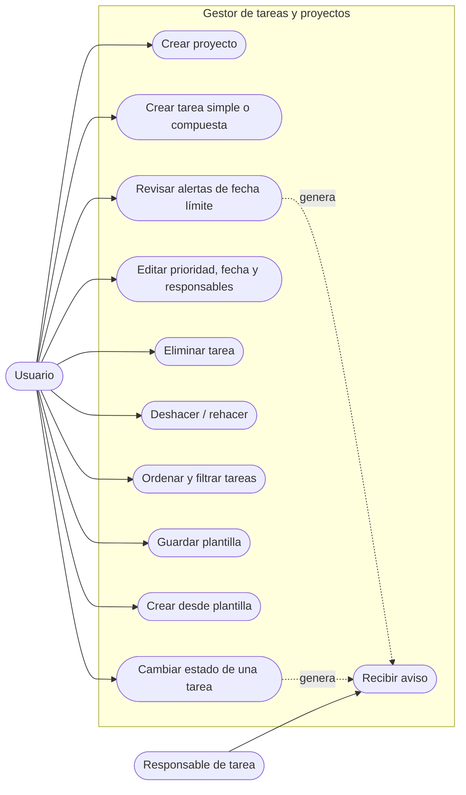
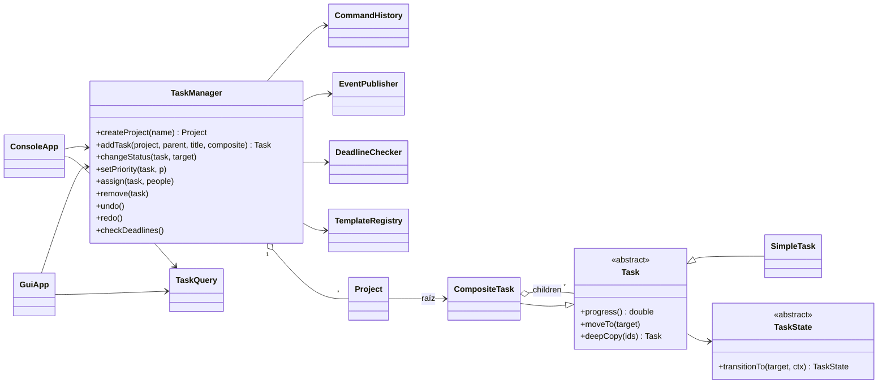
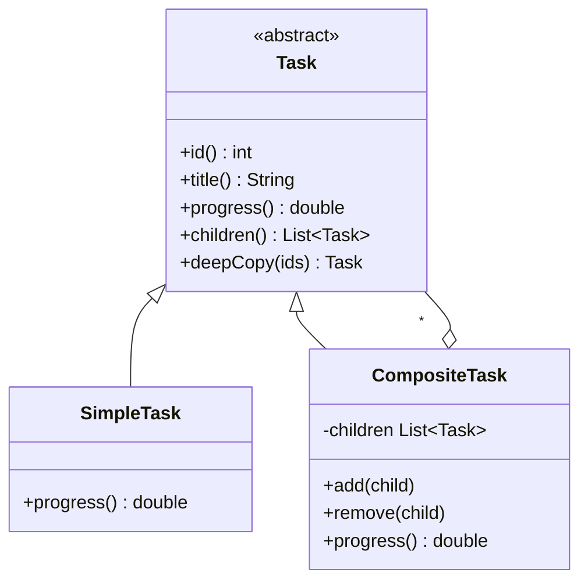
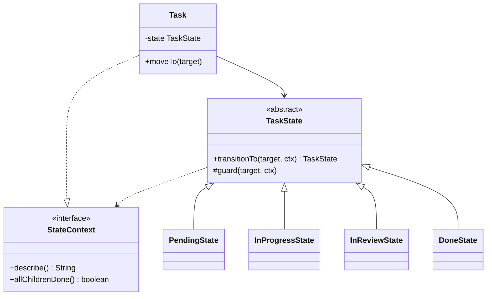
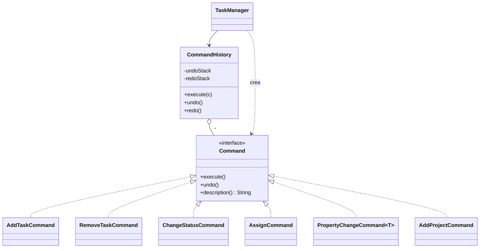
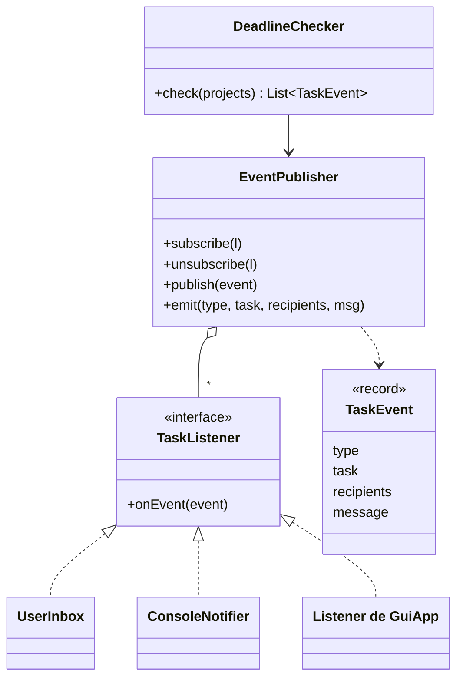
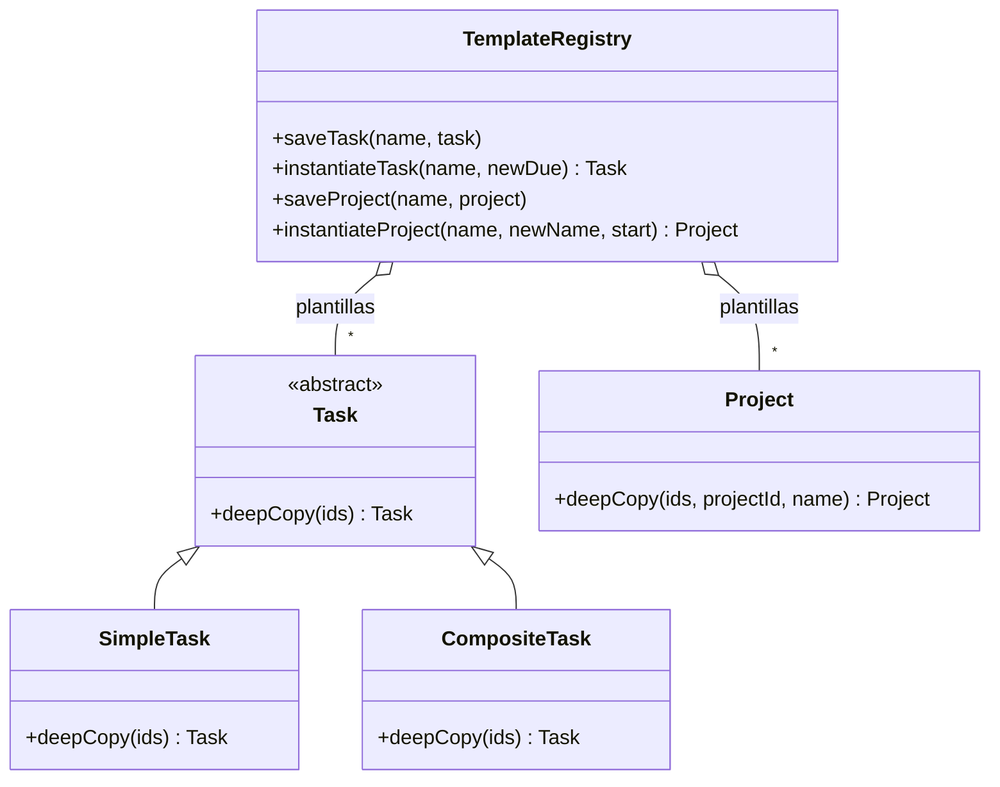
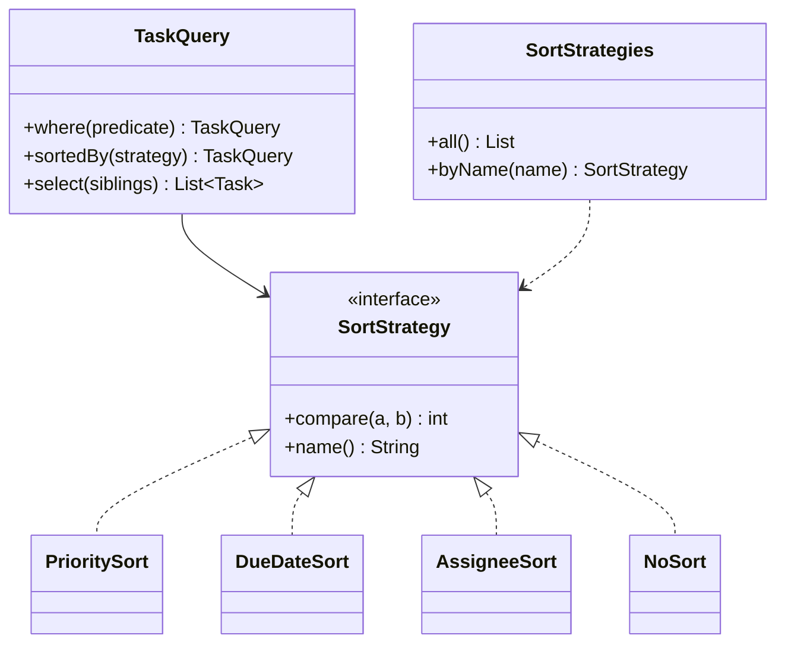
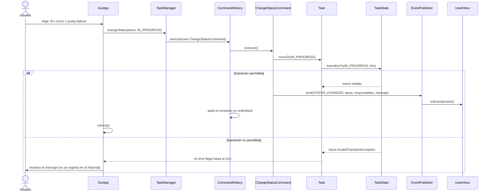

# Gestor de Tareas y Proyectos (Propuesta 2) - GESTOR PRO

**Asignatura:** Ingeniería de Software II - Parcial de Patrones de Diseño  
**Lenguaje:** Java
**Integrantes:**  
- David Andres Fajardo Briceño
- Charlotte Samantha García Galindo 

---

## 1. Definición Inicial del Proyecto

### 1.1 Alcance del sistema
Para este proyecto vamos a construir una aplicación de escritorio en Java enfocada en organizar tareas personales o de un equipo pequeño, permitiendo usar tanto una interfaz por consola como una ventana gráfica sencilla sobre la misma lógica de negocio.

#### **Funcionalidades que se van a implementar:**
- **Tareas simples y tareas compuestas:** Posibilidad de crear tareas individuales o tareas padre (proyectos/módulos) que agrupen varias subtareas.
- **Control de estados y transiciones:** Manejo de los estados *Pendiente*, *En curso*, *En revisión* y *Terminada*, validando qué cambios de estado son válidos y cuáles no.
- **Deshacer y rehacer acciones (Undo / Redo):** Historial en memoria para revertir o volver a aplicar acciones recientes como crear una tarea, editarla, cambiarle el estado o eliminarla.
- **Ordenamiento y filtrado dinámico:** Opciones para listar tareas ordenadas o filtradas por prioridad, fecha límite o persona responsable.
- **Alertas de vencimiento:** Avisos en pantalla cuando existen tareas próximas a vencer o que ya pasaron su fecha límite.

#### **Funcionalidades que quedan por fuera (y por qué):**
- **Plantillas para proyectos recurrentes:** Se dejan por fuera para mantener el alcance realista frente al tiempo de entrega y concentrarnos en que los patrones principales queden bien implementados y con buenas pruebas unitarias.
- **Envío de notificaciones externas (correo o SMS):** No se incluyen porque el sistema funciona de manera local en Java estándar y agregar servidores de correo complicaría la ejecución sin aportar a los patrones centrales del parcial.

---

### 1.2. Requisitos del Sistema

#### Requisitos Funcionales (RF)
- **RF01 - [Tareas]:** El sistema debe permitir crear tareas simples y tareas compuestas (que contienen otras tareas). 
- **RF02 - [Atributos]:** El sistema debe permitir asignar a cada tarea atributos básicos: título, descripción, responsable, fecha límite y nivel de prioridad.  
- **RF03 - [Estados]:** El sistema debe permitir cambiar el estado de una tarea (Pendiente, En curso, En revisión, Terminada) respetando reglas lógicas (ej. no se puede pasar a "Terminada" si está "Pendiente" sin pasar por "En curso"). 
- **RF04 - [Actualización del Estado]:** El sistema debe actualizar automáticamente el estado de una tarea compuesta si todas sus subtareas son marcadas como "Terminadas". 
- **RF05 - [Filtrado y Visualización]:** El sistema debe permitir visualizar la lista de tareas ordenadas y filtradas según el criterio que elija el usuario (por prioridad, por fecha límite o por responsable).

#### Requisitos No Funcionales (RNF)
- **RNF01 - [Lenguaje]:** El sistema debe estar desarrollado en Java. 
- **RNF02 - [Arquitectura dual]:** La lógica de negocio debe estar totalmente separada de las vistas. El sistema debe poder ejecutarse tanto por consola como mediante una interfaz gráfica sencilla usando exactamente el mismo núcleo (core). 
- **RNF03 - [Extensibilidad]:** El código debe aplicar principios SOLID y patrones de diseño (creacionales, estructurales y/o de comportamiento) para resolver problemas de flexibilidad. 
- **RNF04 - [Trabajo colaborativo]:** El proyecto se gestionará en un repositorio Git, donde debe quedar el historial de commits reflejando el trabajo equitativo de los dos integrantes. 
- **RNF05 - [Calidad]:** Las clases críticas donde se apliquen los patrones de diseño deben contar con pruebas unitarias que garanticen su correcto funcionamiento.

---
### 1.3 Problemas de diseño identificados
Si programáramos este gestor de forma directa y sin aplicar patrones, nos encontraríamos con varios problemas a medida que crece el código:

1. **Manejo desigual entre tareas individuales y tareas con subtareas:**  
   Si creamos una clase `Tarea` y otra clase aparte llamada `Proyecto` que guarda una lista de tareas, cada vez que queramos mostrar el listado, calcular el progreso o contar cuántas tareas faltan, tocaría llenar el código de `if (objeto instanceof Proyecto)` y casteos. Además, si luego queremos meter una subtarea dentro de otra subtarea, esa estructura rígida no lo permitiría fácilmente.

2. **Lógica de estados llena de condicionales (`if/else`):**  
   Cada estado de una tarea tiene reglas distintas: una tarea *Pendiente* se puede editar y pasar a *En curso*, pero no se puede dar por *Terminada* de una vez; una tarea *Terminada* ya no debería dejarse modificar ni devolver a *Pendiente*. Si metemos todas esas validaciones dentro de un `switch` gigante en la clase `Tarea`, cualquier cambio o estado nuevo (como *Bloqueada*) obligaría a tocar toda la clase y aumentaría el riesgo de dañar lo que ya funciona.

3. **Dificultad para implementar Deshacer y Rehacer:**  
   El usuario necesita revertir cambios en las tareas. Si intentamos guardar una copia completa de toda la lista de tareas cada vez que alguien edita un título o cambia un estado, gastaríamos memoria innecesaria y además mezclaríamos la lógica de los botones/menús con el historial de cambios.

4. **Ordenamiento y filtrado rígido:**  
   Al principio solo ordenamos por prioridad o fecha, pero en cualquier momento puede surgir la necesidad de ordenar por responsable o filtrar por estado. Si ponemos métodos separados como `ordenarPorFecha()` y `ordenarPorPrioridad()` llenos de condicionales dentro de la clase gestora, cada criterio nuevo obligaría a modificar el núcleo del sistema.
   
---

## 3. Patrones de Diseño Aplicados

Resumen de lo que usamos:

| Patrón | Categoría | Problema que resuelve |
| :--- | :--- | :--- |
| 3.1 Composite | Estructural | Tareas simples y compuestas tratadas igual |
| 3.2 State | Comportamiento | Transiciones de estado permitidas |
| 3.3 Command | Comportamiento | Deshacer y rehacer |
| 3.4 Observer | Comportamiento | Avisos a varios responsables y canales |
| 3.5 Prototype | Creacional | Plantillas de tareas y proyectos recurrentes |
| 3.6 Strategy | Comportamiento | Ordenar con criterios intercambiables |
| 3.7 Facade (apoyo) | Estructural | Una sola entrada al núcleo para consola y GUI |

### 3.1 Patrón Composite (Estructural)

- **Problema concreto:** El sistema debe soportar tanto tareas individuales como tareas compuestas por múltiples subtareas, permitiendo consultar su estado, prioridad o porcentaje de avance sin importar si se trata de una tarea suelta o de un grupo completo.
- **Descripción con palabras propias:** El patrón Composite sirve para armar estructuras en forma de árbol donde las piezas individuales y los grupos de piezas se manejan exactamente igual desde afuera. Así, el resto del programa no tiene que estar preguntando si algo es una tarea sola o una carpeta llena de subtareas; simplemente llama al mismo método y cada objeto responde según lo que es.
- **Correspondencia de roles y clases:**

| Rol del Patrón | Clase / Interfaz en el Proyecto | Responsabilidad |
| :--- | :--- | :--- |
| **Component** | `ComponenteTarea` | Define las operaciones comunes (`getTitulo()`, `obtenerProgreso()`, `mostrarDetalle()`, `cambiarEstado()`). |
| **Leaf (Hoja)** | `TareaSimple` | Representa una tarea individual que no tiene hijos. Su progreso es 100% si está terminada o 0% si no. |
| **Composite** | `TareaCompuesta` | Contiene una lista de `ComponenteTarea` (subtareas) y calcula su progreso promediando el de sus hijos. |

- **Alternativa considerada y por qué se descartó:** Se pensó en crear una clase `Proyecto` totalmente separada de `Tarea` con una lista interna de tareas. Se descartó porque impediría anidar subtareas dentro de otras subtareas y obligaría a duplicar métodos en el servicio para listar y calcular avances por separado.
- **Ventajas, desventajas y relación con SOLID:**
  - *Ventajas:* Simplifica el código cliente (consola y Swing), facilita agregar niveles de subtareas sin cambios estructurales y evita el uso de `instanceof`.
  - *Desventajas:* Puede hacer que la interfaz común tenga métodos (como `agregarSubtarea()`) que no tienen sentido en una `TareaSimple`, obligando a lanzar una excepción controlada si se intentan llamar ahí.
  - *Relación con SOLID:* Cumple con **Abierto/Cerrado (OCP)** porque permite introducir nuevos tipos de componentes sin alterar el código que los recorre, y con **Sustitución de Liskov (LSP)** al permitir que una `TareaCompuesta` se use en cualquier lugar donde se espere un `ComponenteTarea`.

---

### 3.2 Patrón State (Comportamiento)

- **Problema concreto:** Las tareas pasan por cuatro estados (*Pendiente*, *En curso*, *En revisión*, *Terminada*) y existen reglas estrictas sobre qué transiciones son válidas y qué acciones se pueden hacer en cada momento.
- **Descripción con palabras propias:** State consiste en sacar el comportamiento de cada estado fuera de la clase principal y meterlo en clases pequeñas e independientes. En lugar de que la tarea tenga un montón de condicionales revisando en qué estado está parada, la tarea guarda una referencia a un objeto "estado actual" y le delega la decisión de si puede avanzar, retroceder o editarse.
- **Correspondencia de roles y clases:**

| Rol del Patrón | Clase / Interfaz en el Proyecto | Responsabilidad |
| :--- | :--- | :--- |
| **Context** | `ComponenteTarea` | Mantiene la referencia al `EstadoTarea` actual y expone métodos como `iniciar()`, `enviarARevision()` y `finalizar()`. |
| **State** | `EstadoTarea` | Interfaz que declara las transiciones posibles y validaciones según el estado. |
| **ConcreteState** | `EstadoPendiente`, `EstadoEnCurso`, `EstadoEnRevision`, `EstadoTerminada` | Implementan las reglas exactas de cada fase (por ejemplo, `EstadoPendiente` solo permite pasar a `EstadoEnCurso`). |

- **Alternativa considerada y por qué se descartó:** Usar un `enum Estado` junto con bloques `switch` dentro de `Tarea`. Se descartó porque a medida que se agregan reglas (como bloquear la edición cuando ya está *Terminada*), la clase `Tarea` se vuelve muy larga y difícil de leer.
- **Ventajas, desventajas y relación con SOLID:**
  - *Ventajas:* Elimina condicionales repetitivos, hace muy explícitas las transiciones válidas y facilita agregar un estado nuevo en el futuro (por ejemplo, *Cancelada*) creando una sola clase.
  - *Desventajas:* Aumenta la cantidad de clases pequeñas en el paquete de estados, lo cual puede verse algo verboso si las reglas fueran muy simples.
  - *Relación con SOLID:* Aplica **Responsabilidad Única (SRP)** al aislar la lógica de cada estado en su propia clase, y **Abierto/Cerrado (OCP)** al permitir añadir nuevos estados sin modificar la clase `Tarea`.

---

### 3.3 Patrón Command (Comportamiento)

- **Problema concreto:** El usuario necesita poder deshacer y rehacer acciones realizadas sobre las tareas (como crear, eliminar o cambiar de estado) desde ambas interfaces.
- **Descripción con palabras propias:** Command convierte cada acción que pide el usuario en un objeto independiente que sabe cómo ejecutarse y cómo revertirse. De esta forma, podemos guardar esos objetos en dos pilas (una para deshacer y otra para rehacer) sin que la interfaz gráfica ni la consola tengan que saber cómo se revierte internamente cada operación.
- **Correspondencia de roles y clases:**

| Rol del Patrón | Clase / Interfaz en el Proyecto | Responsabilidad |
| :--- | :--- | :--- |
| **Command** | `Comando` | Interfaz con los métodos `ejecutar()` y `deshacer()`. |
| **ConcreteCommand** | `ComandoCrearTarea`, `ComandoEliminarTarea`, `ComandoCambiarEstado`, `ComandoEditarTarea` | Guardan los datos necesarios antes del cambio (como el estado anterior) para poder revertirlo después. |
| **Invoker** | `HistorialComandos` | Administra las pilas `pilaUndo` y `pilaRedo` y ejecuta los comandos solicitados. |
| **Receiver** | `GestorTareasService` / `ComponenteTarea` | Objetos reales sobre los cuales se aplican o revierten las modificaciones. |

- **Alternativa considerada y por qué se descartó:** Se evaluó el patrón *Memento*, guardando una copia completa de toda la lista de tareas antes de cada operación. Se descartó porque clonar árboles completos de tareas compuestas cada vez que se edita un campo consume más memoria y es más propenso a errores de referencia que guardar solo el delta de la acción puntual.
- **Ventajas, desventajas y relación con SOLID:**
  - *Ventajas:* Permite implementar Undo/Redo de manera limpia y reutilizable tanto en consola como en Swing, y desacopla los botones de la lógica que ejecuta la acción.
  - *Desventajas:* Requiere crear una clase nueva por cada operación que queramos que sea reversible.
  - *Relación con SOLID:* Cumple con **Responsabilidad Única (SRP)** al separar la invocación de la ejecución, y con **Abierto/Cerrado (OCP)** porque agregar una nueva acción reversible no requiere tocar el `HistorialComandos`.

---

### 3.4 Patrón Observer (Comportamiento)

- **Problema concreto:** Cuando se acerca una fecha límite, cambia un estado o se asigna una tarea, hay que avisar a **uno o varios responsables** y por distintos canales (consola, panel de la GUI, bandeja por usuario). El núcleo no debía conocer la consola ni Swing.
- **Descripción con palabras propias:** Observer establece una relación de uno a muchos: un objeto publica eventos y muchos otros se suscriben para recibirlos. El que publica no sabe quiénes lo escuchan ni qué hacen con el aviso.
- **Correspondencia de roles y clases:**

| Rol del Patrón | Clase / Interfaz en el Proyecto | Responsabilidad |
| :--- | :--- | :--- |
| **Subject** | `EventPublisher` | Mantiene la lista de suscriptores (`subscribe`, `unsubscribe`) y reparte cada evento (`publish`, `emit`). Si un observador falla, no afecta a los demás. |
| **Observer** | `TaskListener` | Interfaz con `onEvent(TaskEvent)`. |
| **ConcreteObserver** | `UserInbox`, `ConsoleNotifier`, y el listener de la GUI | Guardan avisos por usuario, los imprimen en consola o los muestran en el panel de avisos. |
| **Evento** | `TaskEvent`, `EventType` | Llevan tipo, tarea, **destinatarios**, mensaje y hora. |
| **Quien dispara** | Los comandos y `DeadlineChecker` | Publican creación, cambio de estado, asignación, `DUE_SOON` y `OVERDUE`. |

  `DeadlineChecker` recibe un `Clock` por constructor, por lo que en las pruebas se "avanza el tiempo" sin esperar, y recuerda qué avisos ya envió para no repetirlos.
- **Alternativa considerada y por qué se descartó:** Que el código que detecta la fecha límite llame directamente a `System.out.println` o a un método de la GUI. Se descartó porque ataría el núcleo a una interfaz concreta y habría que duplicar código para la otra. También se pensó en un hilo con temporizador por cada tarea, pero es más difícil de probar y de controlar.
- **Ventajas, desventajas y relación con SOLID:**
  - *Ventajas:* Un canal nuevo (correo, archivo) es una clase que se suscribe; el núcleo no conoce las interfaces; se prueba fácil con el reloj inyectado.
  - *Desventajas:* Las notificaciones son síncronas (un observador lento retrasa la acción); la revisión de fechas es por *polling* (la GUI revisa cada 30 segundos y la consola con `alertas`); los avisos ya enviados se recuerdan solo en memoria; es más difícil seguir el flujo de ejecución.
  - *Relación con SOLID:* **OCP** (nuevos canales sin cambiar al sujeto), **DIP** (el sujeto depende de `TaskListener`) y **SRP** (detectar fechas, repartir eventos y mostrarlos son tareas separadas).

---

### 3.5 Patrón Prototype (Creacional)

- **Problema concreto:** Hay trabajo que se repite (un sprint, el cierre mensual). Queríamos guardar un modelo con todas sus subtareas, prioridades y responsables y crear copias nuevas cada vez, sin que la copia comparta nada con el modelo.
- **Descripción con palabras propias:** Prototype crea objetos nuevos **copiando uno que ya existe** en lugar de armarlos desde cero. Aquí la copia es profunda: se copia también todo el árbol de subtareas.
- **Correspondencia de roles y clases:**

| Rol del Patrón | Clase / Interfaz en el Proyecto | Responsabilidad |
| :--- | :--- | :--- |
| **Prototype** | `Task` (método abstracto `deepCopy(IdGenerator)`) | Declara cómo se copia una tarea. |
| **ConcretePrototype** | `SimpleTask`, `CompositeTask` (copia también a cada hijo), `Project` | Cada clase copia sus propios datos. La copia recibe ids nuevos y empieza siempre en Pendiente. |
| **Registro de prototipos** | `TemplateRegistry` | Guarda copias con nombre (`saveTask`, `saveProject`) y entrega copias nuevas (`instantiateTask`, `instantiateProject`). Puede desplazar todas las fechas en bloque. |
| **Client** | `TaskManager` | `addTaskFromTemplate` y `createProjectFromTemplate` insertan la copia mediante un comando, por lo que se puede deshacer. |

- **Alternativa considerada y por qué se descartó:** Un Builder o un método fábrica del tipo "crear sprint" que arme las tareas desde código. Se descartó porque las plantillas quedarían fijas en el programa y el usuario no podría crear las suyas. Con Prototype, cualquier tarea o proyecto que el usuario arme puede ser plantilla.
- **Ventajas, desventajas y relación con SOLID:**
  - *Ventajas:* El usuario crea plantillas sin programar; la copia es independiente del modelo; la lógica de copia está en la clase que conoce sus datos.
  - *Desventajas:* Hay que mantener `deepCopy` al día si se agregan atributos a `Task` (por eso existe `copyAttributesTo`, pero depende de que alguien lo recuerde); las plantillas no se guardan en disco; los ids de las plantillas consumen números de la secuencia.
  - *Relación con SOLID:* **OCP** (un nuevo tipo de tarea implementa su `deepCopy` sin cambiar el registro) y **SRP** (el registro solo guarda y entrega, no sabe copiar). Punto débil: `Project` no comparte interfaz con `Task`, por lo que el registro usa dos mapas.

---

### 3.6 Patrón Strategy (Comportamiento)

- **Problema concreto:** El sistema debe permitir ordenar y filtrar las tareas por distintos criterios (prioridad, fecha límite o responsable) y estar preparado para añadir criterios nuevos fácilmente.
- **Descripción con palabras propias:** Strategy consiste en encapsular diferentes formas de hacer una misma tarea (en nuestro caso, ordenar o filtrar una lista) dentro de clases intercambiables. Así el gestor principal no tiene quemada una única forma de ordenar, sino que recibe la estrategia que el usuario escoja en ese momento y la aplica sobre las tareas.
- **Correspondencia de roles y clases:**

| Rol del Patrón | Clase / Interfaz en el Proyecto | Responsabilidad |
| :--- | :--- | :--- |
| **Context** | `GestorTareasService` | Recibe una estrategia activa y la utiliza cuando se solicita el listado de tareas. |
| **Strategy** | `EstrategiaOrden` / `EstrategiaFiltro` | Interfaces que definen el contrato `ordenar(List<ComponenteTarea>)` y `filtrar(List<ComponenteTarea>)`. |
| **ConcreteStrategy** | `OrdenPorPrioridad`, `OrdenPorFecha`, `OrdenPorResponsable`, `FiltroPorResponsable`, `FiltroPorPrioridad` | Implementan cada criterio específico de comparación o filtrado. |

- **Alternativa considerada y por qué se descartó:** Implementar `Comparable` directamente en `ComponenteTarea` o poner varios `if` en el servicio según un parámetro de texto. Se descartó porque `Comparable` solo permite un orden natural fijo y los `if` obligarían a modificar el servicio cada vez que se pida un ordenamiento nuevo.
- **Ventajas, desventajas y relación con SOLID:**
  - *Ventajas:* Permite cambiar el criterio de ordenamiento o filtrado en tiempo de ejecución desde un combo box en Swing o una opción en consola, y facilita agregar criterios nuevos en segundos.
  - *Desventajas:* El cliente o controlador debe conocer qué estrategias existen para instanciar la correcta según la selección del usuario.
  - *Relación con SOLID:* Cumple con **Abierto/Cerrado (OCP)** al permitir añadir nuevas estrategias sin tocar el gestor, y con **Inversión de Dependencias (DIP)** porque `GestorTareasService` depende de la abstracción `EstrategiaOrden` y no de implementaciones concretas.

---

### 3.7 Patrón Facade (de apoyo, Estructural)

- **Problema concreto:** La consola y la GUI necesitan coordinar proyectos, comandos, eventos, plantillas y alertas. Si cada interfaz hablara con todas esas clases, la lógica se repetiría.
- **Descripción con palabras propias:** Facade ofrece una sola clase sencilla que esconde el trabajo conjunto de muchas otras.
- **Correspondencia de roles y clases:**

| Rol del Patrón | Clase / Interfaz en el Proyecto | Responsabilidad |
| :--- | :--- | :--- |
| **Facade** | `TaskManager` | Recibe peticiones como `changeStatus(task, target)`, crea el comando, lo ejecuta en el historial y deja la acción deshacible y notificada. |
| **Subsistema** | `CommandHistory`, `EventPublisher`, `DeadlineChecker`, `TemplateRegistry`, `Project` | Clases internas que coordina. |
| **Client** | `ConsoleApp`, `GuiApp` | Solo conocen a `TaskManager`. |

- **Alternativa considerada y por qué se descartó:** Que cada interfaz use directamente todas las clases del núcleo. Se descartó por duplicar lógica y acoplar las interfaces al núcleo.
- **Ventajas, desventajas y relación con SOLID:**
  - *Ventajas:* Un único punto de entrada; consola y GUI son capas finas.
  - *Desventajas:* `TaskManager` tiende a crecer y habría que dividirlo si el proyecto aumentara.
  - *Relación con SOLID:* **DIP** (las interfaces dependen de una sola clase del núcleo).

---

## 4. Arquitectura General

### Separación de capas

- **Lógica de negocio (`core.model`, `core.state`, `core.command`, `core.notify`, `core.template`, `core.query`):** Contiene las reglas del problema: las tareas y proyectos (Composite), los estados y sus transiciones (State), las acciones deshacibles (Command), los eventos y alertas (Observer), las plantillas (Prototype) y los criterios de orden y filtro (Strategy). Se mantiene independiente porque **no importa nada de `cli` ni de `gui`** (ni `System.out`, ni Swing). Incluso `core.state` no depende de `core.model`, porque usa la interfaz `StateContext`, y el tiempo entra por un `Clock` inyectado, lo que permite probarla sin interfaz y sin esperar.
- **Capa de servicio (`core.service`):** `TaskManager` es la fachada. Crea los comandos, los ejecuta en el historial, administra proyectos, plantillas y alertas, y es el único punto de entrada al núcleo. Así las reglas (por ejemplo, "esta acción se puede deshacer y avisa a los responsables") se aplican siempre igual, sin importar desde qué interfaz se use.
- **Interfaz de consola (`cli`):** `ConsoleApp` interpreta el texto escrito por el usuario (comandos como `nueva`, `estado`, `listar`, `deshacer`) y llama a métodos de `TaskManager`. Los errores de reglas (`InvalidTransitionException` y otros) se muestran como mensajes. `ConsoleMain` suscribe un `ConsoleNotifier` para ver los avisos.
- **Interfaz gráfica (`gui`):** `GuiApp` (Swing) muestra el árbol de tareas, el detalle, los filtros y el panel de avisos. Para todo lo que modifica datos llama a los mismos métodos de `TaskManager`, y para ordenar y filtrar usa `TaskQuery`. Se suscribe al `EventPublisher` para mostrar avisos, y un temporizador revisa las fechas límite cada 30 segundos.

### Estructura de paquetes del repositorio

```text
src/
├── main/
│   └── java/
│       └── com/gestor/
│           ├── core/
│           │   ├── model/       Task, SimpleTask, CompositeTask, Project, Priority
│           │   ├── state/       TaskState, PendingState, InProgressState, InReviewState,
│           │   │                DoneState, TaskStatus, StateContext, InvalidTransitionException
│           │   ├── command/     Command, CommandHistory, AddTaskCommand, RemoveTaskCommand,
│           │   │                ChangeStatusCommand, AssignCommand, PropertyChangeCommand,
│           │   │                AddProjectCommand
│           │   ├── notify/      EventPublisher, TaskListener, TaskEvent, EventType,
│           │   │                DeadlineChecker, UserInbox, ConsoleNotifier
│           │   ├── template/    TemplateRegistry
│           │   ├── query/       SortStrategy, PrioritySort, DueDateSort, AssigneeSort,
│           │   │                NoSort, SortStrategies, Filters, TaskQuery
│           │   ├── service/     TaskManager, DemoData
│           │   └── util/        IdGenerator, Dates, Texts
│           ├── cli/             ConsoleApp, ConsoleMain
│           └── gui/             GuiApp, TaskTreeRenderer
└── test/
    └── java/
        └── com/gestor/
            ├── core/            StatePatternTest, CompositePatternTest, CommandPatternTest,
            │                    ObserverPatternTest, PrototypePatternTest, StrategyPatternTest,
            │                    TaskManagerTest, TestClock
            └── cli/             ConsoleAppTest
```

---

## 5. Pruebas y conclusiones

### 5.1 Pruebas unitarias

| Clase de pruebas | Qué comprueba |
| :--- | :--- |
| `StatePatternTest` | Transiciones válidas e inválidas; un grupo no termina con subtareas pendientes; el estado no cambia si la transición falla |
| `CompositePatternTest` | Progreso, anidamiento, ciclos prohibidos, copia profunda independiente |
| `CommandPatternTest` | Ejecutar, deshacer, rehacer; el historial ignora comandos fallidos; eliminar restaura la posición |
| `ObserverPatternTest` | Varios suscriptores; un observador que falla no afecta a otros; alertas a todos los responsables sin repetirse |
| `PrototypePatternTest` | Copias independientes, ids nuevos, estado Pendiente, fechas desplazadas, plantillas de proyecto |
| `StrategyPatternTest` | Los tres criterios de orden, orden invertido, filtros combinados, jerarquía conservada |
| `TaskManagerTest` | Los patrones trabajando juntos desde la fachada |
| `ConsoleAppTest` | La consola sobre el mismo núcleo |

En total son 62 pruebas. El reloj se inyecta (`TestClock`), así que las alertas se prueban sin esperas reales.

### 5.2 Qué aprendimos
- Un patrón tiene sentido cuando hay un problema real detrás. Los que más se notaron fueron Command (deshacer sale casi gratis una vez que cada acción es un objeto) y State (ya que las reglas quedaron separadas y claras).
- Separar el núcleo de las interfaces nos ahorró trabajo: la GUI y la consola se escribieron con poco código porque la lógica ya estaba hecha.
- Inyectar dependencias, como el reloj, hace que las pruebas sean rápidas y fiables.
Los patrones se combinan: un cambio de estado es un Command, que usa State y publica un evento de Observer.

### 5.3 Qué cambiaríamos
- La persistencia. Hoy todo se pierde al cerrar, entonces nosotros guardaríamos proyectos, tareas y plantillas en un archivo (por ejemplo JSON) o en una base de datos.
- Estado como enum más datos. Si los estados necesitaran información propia, habría que dejar de usar singletons.
- El proyecto usa una CompositeTask raíz con id 0 para reutilizar el Composite. Funciona, pero es un atajo,  un diseño más limpio separaría el contenedor.
- Cambiariamos las alertas. Cambiaríamos el polling por un planificador (ScheduledExecutorService) y guardaríamos los avisos ya enviados.
- TaskManager demasiado grande, lo dividiríamos en servicios más pequeños (proyectos, tareas, plantillas).
- El límite del historial. Pondríamos un máximo de acciones deshacibles.
- Permitiríamos ordenar por varios criterios a la vez.
- Interfaz Task más pequeña. Separar lo que solo necesitan los grupos para respetar mejor el principio de segregación de interfaces.

---

## 6. Diagramas UML

### 6.1 Diagrama de Casos de Uso


### 6.2 Diagrama de Clases General



### 6.3 Diagramas de Clases por Patrón

#### Patrón 1 - Composite



#### Patrón 2 - State



#### Patrón 3 - Command



#### Patrón 4 - Observer



#### Patrón 5 - Prototype



#### Patrón 6 - Strategy




### 6.4 Diagrama de Secuencia
Cambiar el estado de una tarea desde la GUI (la consola sigue el mismo camino a partir de `TaskManager`):



---

## 7. Instrucciones de Compilación y Ejecución

### Requisitos previos
- Java JDK [17 / 21] instalado.
- Maven 3.8+ (opcional). También se puede compilar manualmente con javac usando ./build.sh.

### Ejecutar versión por Consola
```bash
# Con Maven
mvn package
java -jar target/gestor-tareas-1.0.0.jar            # agregar --demo para datos de ejemplo

# Sin Maven
./build.sh
java -cp out com.gestor.cli.ConsoleMain --demo
```

### Ejecutar versión con Interfaz Gráfica (GUI)
```bash
# Con Maven
mvn package
java -cp target/gestor-tareas-1.0.0.jar com.gestor.gui.GuiApp --demo

# Sin Maven
./build.sh
java -cp out com.gestor.gui.GuiApp --demo
```

### Ejecutar Pruebas Unitarias
```bash
# Con Maven
mvn test

# Sin Maven (indicando la ruta al jar de JUnit Console Standalone)
./build.sh test /ruta/junit-platform-console-standalone-1.10.x.jar
```

---

## 8. Integridad Académica y Declaración de Herramientas

- 

